<picture>
  <source media="(max-width: 600px) and (prefers-color-scheme: dark)" srcset="assets/banner-dark-mobile.svg">
  <source media="(max-width: 600px)" srcset="assets/banner-light-mobile.svg">
  <source media="(prefers-color-scheme: dark)" srcset="assets/banner-dark.svg">
  
</picture>

### Currently working on

- Advanced Machine Learning final project: **Time Series Generation for Glucose Data**
- Building **[Momentum Tennis](https://github.com/ChrisMedkit/Momentum-Tennis)**, my math modeling final project, where we are modeling how to determine if there is momentum in tennis matches from Wimbledon 2023

### Featured work

<table>
<tr>
<td width="50%" valign="top">

 
<b><a href="https://github.com/ChrisMedkit/3D-L-systems">3D L-Systems</a></b>
 
Procedurally generated 3D trees and plants, made with a custom Blender add-on and shown on a website
</td>
<td width="50%" valign="top">

 
<b><a href="https://github.com/ChrisMedkit/Momentum-Tennis">Momentum Tennis</a></b>
 
A website built with AI, with notes on the pitfalls and wins of coding with an LLM
</td>
</tr>
<tr>
<td width="50%" valign="top">

 
<b><a href="https://github.com/ChrisMedkit/MSCS-335-Machine-Learning">Machine Learning</a></b>
 
Notebooks and assignments from ML at Sejong University
</td>
<td width="50%" valign="top">

 
<b><a href="https://github.com/ChrisMedkit/MSCS-271-Formal-Language-Finite-Automota---2025">Formal Languages &amp; Automata</a></b>
 
DFAs, NFAs and grammars, written in C++
</td>
</tr>
</table>

### Coursework archive

Click to expand

| Course | Language |
|:---|:---|
| [CS 144: Computer Science I](https://github.com/ChrisMedkit/CS-144-Computer-Science-2023) | Java |
| [CS 145: Computer Science II](https://github.com/ChrisMedkit/CS-145-Computer-Science-II-2024) | Java |
| [CS 241: Data Structures & Algorithms](https://github.com/ChrisMedkit/CS-241-Data-Structures-and-Algorithms-2024) | C++ |
| [CS 324: Database Systems](https://github.com/ChrisMedkit/CS-324-Database-Systems-2024) | SQL |
| [MSCS 271: Formal Languages & Finite Automata](https://github.com/ChrisMedkit/MSCS-271-Formal-Language-Finite-Automota---2025) | C++ |
| [MSCS 335: Machine Learning](https://github.com/ChrisMedkit/MSCS-335-Machine-Learning) | Python, Jupyter |
| [PHYS 281: University Physics I](https://github.com/ChrisMedkit/PHYS-281-University-Physics-I) | Python |

### Interests

I'm into procedural generation, machine learning, algorithms, automata theory and web dev.

 

<picture>
  <source media="(max-width: 600px) and (prefers-color-scheme: dark)" srcset="assets/footer-dark-mobile.svg">
  <source media="(max-width: 600px)" srcset="assets/footer-light-mobile.svg">
  <source media="(prefers-color-scheme: dark)" srcset="assets/footer-dark.svg">
  
</picture>
